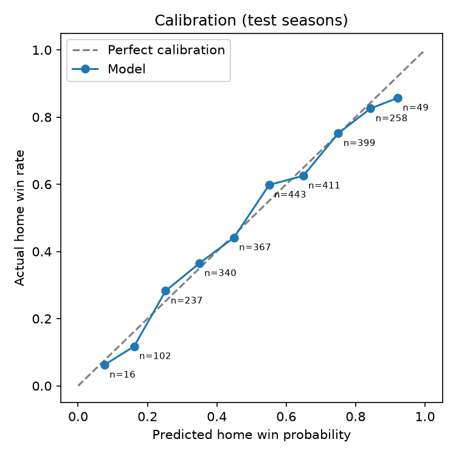

# NBA Win Probability Model

A recency-weighted rating model that turns recent point margins into win probabilities for
NBA games. It's evaluated with a walk-forward backtest (no future data ever leaks in) and
tracked live, with every prediction committed to GitHub before tip-off, during the 2026-27 season.

**Key results (2024-25 and 2025-26 seasons, 2,622 games the model never saw during tuning):**
- Picked the winner in **67.6%** of games, vs. 55.0% for "always pick the home team" and 65.3% for "pick the better record"
- Log loss **0.606** vs. 0.688 for the home-team baseline and 0.693 for a coin flip
- Live 2026-27 record: season starts Oct 20, 2026 (updated monthly)

## Question
Can a simple rating built from recent point margins predict NBA winners better than the
rules a casual fan would use, and are its probabilities *honest*? When it says 70%, does
the favorite actually win about 70% of the time?

## Data
Kaggle: *Historical NBA Data and Player Box Scores* (TeamStatistics.csv), 2022-23 through 2025-26
regular season and playoffs (5,248 games).
Each game appears once per team in the raw file, so the loader keeps one row per game (the home
team's side) and builds full team names so the Lakers and Clippers stay separate.
The data isn't stored in this repo; download it into `data/`.

## Method
1. **Team rating** = weighted average point margin, where a game from *w* weeks ago gets weight `decay^w`.
   Recent games count more because rosters, injuries, and form change during a season.
2. **Blowout cap:** margins are capped at ±20 points before computing ratings, so garbage-time
   blowouts don't overstate how good a team is (see *Experiment 1* below).
3. **Strength of schedule:** each margin is adjusted by the opponent's rating, so a
   close loss to a top team counts more than a close win over a weak one.
4. **Win probability:** `P(home wins) = 1 / (1 + e^-(a * gap + b))`, where `gap` = home rating - away rating.
   Logistic regression learns `a` (how much each point of rating gap matters) and `b` (home-court edge).

## Why the test is honest
- **Walk-forward:** to predict a game, the model only uses games played *before* that day.
- **Separate tuning and test seasons:** decay, strength of schedule, `a`, `b`, and whether to use
  the blowout cap are all decided using 2023-24 only. The reported results come from 2024-25 and
  2025-26, which the model never saw while being tuned.
- **Baselines:** the model is compared against simple rules, not just against random guessing.
- **Live tracking:** 2026-27 predictions are committed before games start, so the timestamps prove they weren't made after the fact.

## Results (test seasons 2024-25 and 2025-26, 2,622 games)
| Method                       | Accuracy  | Log loss  | Brier     |
|------------------------------|-----------|-----------|-----------|
| **Model (with blowout cap)** | **0.676** | **0.606** | **0.209** |
| Model (original, no cap)     | 0.675     | 0.606     | 0.209     |
| Always pick home team        | 0.550     | 0.688     | 0.248     |
| Better record so far         | 0.653     | -         | -         |
| Coin flip                    | 0.500     | 0.693     | 0.250     |

Best settings (chosen on 2023-24): decay = 0.95 per week (a game's weight halves about every 13.5 weeks),
strength of schedule = on, blowout cap = ±20 points.

**Tuning (2023-24 log loss, lower is better; original model without the cap):**
| Decay | 0.80 | 0.85 | 0.90 | 0.92 | 0.95 | 0.98 | 1.00 (no recency) |
|-------|------|------|------|------|------|------|-------------------|
| Without SoS | 0.6275 | 0.6242 | 0.6177 | 0.6143 | 0.6105 | 0.6115 | 0.6170 |
| With SoS    | 0.6210 | 0.6181 | 0.6141 | 0.6120 | **0.6095** | 0.6110 | 0.6168 |

**Calibration:** predictions grouped into 10% buckets, compared with how often the home team actually won.
Dots near the dashed line mean the probabilities can be trusted. For example, in games the model
gave the home team about 75%, the home team won 75.2% of the time (399 games).



## Key findings
- **Recency helps, but only moderately.** Weighting recent games (decay 0.95) beat treating every
  game equally (decay 1.00), but heavy recency (decay 0.80) was the worst setting tested.
  Chasing short-term streaks adds more noise than signal.
- **Strength of schedule gave a small, consistent improvement,** lowering log loss at every decay setting.
- **Home-court edge is smaller than its historical reputation.** The original model learned about
  1.8 points, compared with the roughly 3 points often cited from earlier eras.
- **The model beats "better record" by about 2 percentage points** (67.6% vs. 65.3%), a real but
  modest gain, which is typical for NBA prediction.
- **Probabilities are well calibrated in the middle range.** The most extreme predictions (above 90%)
  were somewhat overconfident, but that bucket had only 49 games.

## Experiment 1: Capping blowouts
**Hypothesis:** big blowouts often come from starters resting late in games, so they overstate how
much better one team is. Capping each game's margin at ±20 points (for ratings only, not for who won)
should make ratings more accurate.

| | No cap | Cap = ±20 |
|---|---|---|
| Best tuning log loss (2023-24) | 0.6095 | **0.6087** |
| Test log loss (2024-26) | 0.6063 | **0.6058** |
| Test accuracy | 67.54% | **67.62%** |
| Test Brier score | 0.2092 | **0.2091** |

**Result:** the cap improved the tuning-season log loss, so it was kept, following the rule of
deciding only on 2023-24. It also improved slightly on the test seasons. The gain is very small
and may be within random noise; significance testing is the next step.

**Side effect:** capping squeezes rating gaps closer together, so the learned slope `a` rose from
0.130 to 0.160 (each rating point now matters more). Because the rating scale changed, the home
edge in rating points (1.42 with the cap) isn't directly comparable to the original 1.76.

The original results are kept in [`results_baseline/`](results_baseline/) for comparison.
[`check_cap.py`](check_cap.py) is a small test confirming the cap works (a 40-point win counts as 20).

## What I learned
- **Good-looking numbers can be wrong.** My first version printed 69.45% accuracy, but those
  numbers were hard-coded, and the code was counting every game twice. Now I check how a result
  was calculated before I trust it.
- **Testing honestly is harder than building the model.** I learned to choose settings using one
  season and test on seasons the model never saw. Otherwise I'd just be fooling myself into
  thinking the model was better than it is.
- **Small improvements are hard to get and hard to prove.** Capping blowouts only lowered log loss
  from 0.6095 to 0.6087. Writing that code myself was the first time I tested my own idea, and
  reporting a tiny result honestly felt more useful than overselling it.

## Limitations
- Ignores injuries, rest days, and trades, so it reacts to them only after they show up in results.
- Early-season ratings lean on last season's games and don't account for offseason roster changes.
- Small improvements (like the blowout cap) haven't yet been tested for statistical significance.

## Next steps
- **Significance testing:** bootstrap confidence intervals for accuracy and log loss, and a test of
  whether the model's edge over "better record" (and the blowout cap's gain) is real
- **Stronger benchmarks:** an Elo rating model, and betting-market probabilities if data is available
- Add rest days / back-to-backs as a feature
- Short research write-up of methods and results

## Live 2026-27 season tracking
Weekly picks are committed before tip-off in [`predictions/log.csv`](predictions/log.csv).
- **Week 1 (Oct 20-26):** made with the original model (no blowout cap)
- **Week 2 onward:** made with the blowout cap

Running record: updated monthly once games begin.

## Project structure
```
src/data.py          load Kaggle data -> one row per game
src/model.py         recency-weighted ratings, blowout cap, strength of schedule, win probability
src/backtest.py      tuning, walk-forward test, baselines, calibration chart
src/predict.py       live picks and scoring for the current season
src/list_teams.py    prints exact team names for data/upcoming.csv
check_cap.py         test that the blowout cap works
data/upcoming.csv    this week's schedule (input for live picks)
results/             current model: metrics, tuning table, calibration chart
results_baseline/    original model (no cap), kept for comparison
predictions/         live 2026-27 picks
```

## How to run
```
pip install -r requirements.txt
python src/backtest.py --tune 2024 --test 2025 2026
python check_cap.py             # should print Team A: 20.0, Team B: -20.0
python src/predict.py picks     # before games: reads data/upcoming.csv
python src/predict.py score     # after games: running accuracy
```

*Built by Aarav Sandip.*